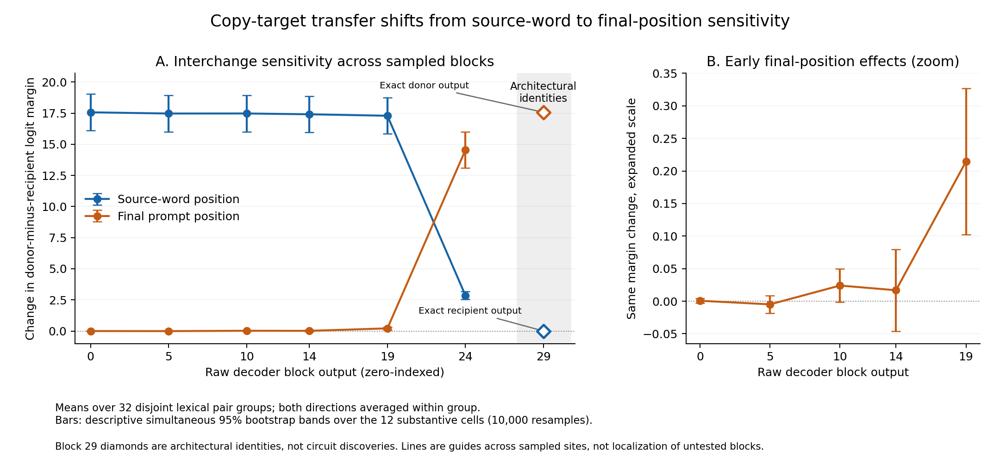

# Copy-target activation interchange in SmolLM2-135M-Instruct

## Finding

In this fixed 64-prompt panel, replacing the source-word residual stream with its paired donor was strongly effective through sampled block 19. By block 24, final-position replacement was substantially more effective: it produced 60 genuine donor switches among 63 baseline-correct prompts, versus zero for source-word replacement. This is a coarse-grid change in **interchange sensitivity**, not evidence that information is exclusively stored at one position or that a unique circuit has been identified.



## Design and completeness

The pinned model revision is `12fd25f77366fa6b3b4b768ec3050bf629380bac`. The experiment used a fixed copy-target prompt, 64 single-token words arranged into 32 disjoint lexical pair groups, and both donor/recipient orientations. All 219 candidate words passed tokenizer-only screening; a deterministic frozen ordering selected 64. Original candidate provenance and exclusions remain in the source/data package. No outcome-based word replacement occurred.

Raw decoder outputs were patched after zero-indexed blocks 0, 5, 10, 14, 19, 24 and 29. These are direct block-output hooks, not the final normalized hidden-state API. The six fixed conditions were donor word, donor final position, donor causal-prefix negative control, identity word, identity final position and whole-state donor. All 128 baseline and 2,688 patch forwards completed, exactly 2,816 total. All 42 cells contain all 64 orientations. Full 49,152-token float32 logit vectors and baseline residual caches are retained.

Baseline greedy accuracy was 63/64, with positive target-versus-paired-foil margin in 64/64 and joint competence in 31/32 pairs. The failed `front` row (row 58, pair 29, paired with `room`) remains in every raw analysis. Only the prespecified normalized-transfer panel excludes pair 29; it uses 31 pairs. Genuine-switch rates condition on the 63 baseline-correct orientations, whereas raw effects include all 64.

## Primary numerical map

Raw effect is the patched minus untouched value of the donor-minus-recipient logit margin. Two directions are averaged inside each lexical group before group resampling. Bands below are approximate descriptive simultaneous 95% max-standardized bootstrap bands over the 12 substantive cells, using 10,000 resamples and seed 20261022. The 32 disjoint investigator-selected groups are the resampling units, **not independent random English-word samples**. These bands describe the fixed panel rather than population coverage.

| Block | Replacement | Mean raw effect | Simultaneous band | Genuine switches | Off-target outputs |
|---:|---|---:|---|---:|---:|
| 0 | donor_word | 17.566 | [16.093, 19.038] | 62/63 | 1/64 |
| 0 | donor_final | 0.00068392 | [-0.0026086, 0.0039764] | 0/63 | 1/64 |
| 5 | donor_word | 17.468 | [16.009, 18.927] | 63/63 | 0/64 |
| 5 | donor_final | -0.0048896 | [-0.01844, 0.0086605] | 0/63 | 0/64 |
| 10 | donor_word | 17.472 | [16.001, 18.944] | 62/63 | 1/64 |
| 10 | donor_final | 0.024018 | [-0.0015836, 0.049619] | 0/63 | 0/64 |
| 14 | donor_word | 17.408 | [15.949, 18.866] | 62/63 | 1/64 |
| 14 | donor_final | 0.016801 | [-0.045865, 0.079468] | 0/63 | 1/64 |
| 19 | donor_word | 17.29 | [15.83, 18.75] | 62/63 | 1/64 |
| 19 | donor_final | 0.2145 | [0.10224, 0.32676] | 0/63 | 1/64 |
| 24 | donor_word | 2.8522 | [2.5424, 3.162] | 0/63 | 3/64 |
| 24 | donor_final | 14.547 | [13.094, 16] | 60/63 | 3/64 |
| 29 | donor_word | 0 | architectural identity | 0/63 | 1/64 |
| 29 | donor_final | 17.563 | architectural identity | 62/63 | 1/64 |

At block 19, final-position replacement has a small positive descriptive simultaneous band but causes no genuine donor switches. At block 24, it has a large raw effect and 60/63 switches. Source-word replacement at block 24 still changes the continuous margin, but produces no donor switches. These distinctions prevent treating a small continuous shift, a positive paired margin and a greedy donor response as interchangeable outcomes.

## Controls and limitations

All full-vocabulary identity, causal-prefix and whole-state donor comparisons have maximum absolute error exactly zero. At block 29, word replacement leaves the recipient output unchanged and final-position replacement reproduces the donor output exactly; these are architectural endpoint identities, not discoveries about a circuit. The final normalized state is not mislabeled as decoder block 29.

Only seven sites and two substantive position interventions were sampled. The plot connects sampled sites for readability and does not localize a precise transition block, identify a head, establish necessity, exclude distributed representations or demonstrate brain correspondence. Observations are restricted to one model checkpoint, one prompt template and this lexical panel. Interventions can change multiple features simultaneously. No extra forwards, warmup probes, retries, new words or changed thresholds were used. Zero-width descriptive intervals for deterministic controls do not imply population certainty.

## Reproducibility and resource record

The integrated audit accepted the enclosing resource evidence and independently reconstructed coverage, metrics, controls, baseline eligibility and bootstrap summaries. A separate independent audit also passed. Full outcome records include exact ties, negative effects, normalized overshoots, donor/recipient probabilities, full-vocabulary KL, requested/realized residual norms and all control cells; see `all-cells.csv`, `ALL_CELLS.md` and the original machine-readable summary. The CSV is a display extract, not a replacement for raw vectors.

Patch execution used 337.209421 seconds wall time and 620.721433 child CPU seconds; final RSS upper bound was 1,500,536,832 bytes. Baseline plus patch used 354.950409 seconds wall time and 577,232,014 retained bytes, within the frozen caps. Resource scope is a trusted single-process worker including threads, sampled CPU/RSS with final rejection and an independent wall watchdog, not kernel containment or process-tree accounting.

Frozen source-manifest SHA-256: `a409cf98be9a0b9f796fbd049ba68fdff64774bfe771e33e6e96d6e6c9a4a00c`. Data-freeze SHA-256: `682817f580c5bd852b7e41c98a760754242e6324e4972876e0e3b90acddfc368`. Baseline inner manifest: `9f934a76fc5b72082a8c1ac5e1dfc381f9cc8557ace5f06611fa9be9c0dff109`. Patch inner manifest: `7c8b1852a054435466c496321b6860457e53327dbdeb353c14afc42d62214306`.

`derive_tables.py` deterministically extracts the CSVs from the sealed summary after an accepted integrated audit. `plot_transfer.py` reads the CSV without model loading or new statistical fitting and writes PNG/SVG/PDF. Existing Matplotlib was used, with its actual version recorded in `PLOTTING_RUNTIME.json`. Display derivation and plotting are subsequent reporting steps, not amendments to the frozen experiment.

Example retained-data rendering:

```sh
python derive_tables.py --summary PATCH_PHASE/evidence/summary.json --audit PATCH_AUDIT.json --out .
python plot_transfer.py --table transfer-plot-input.csv --out .
python write_report.py
```
